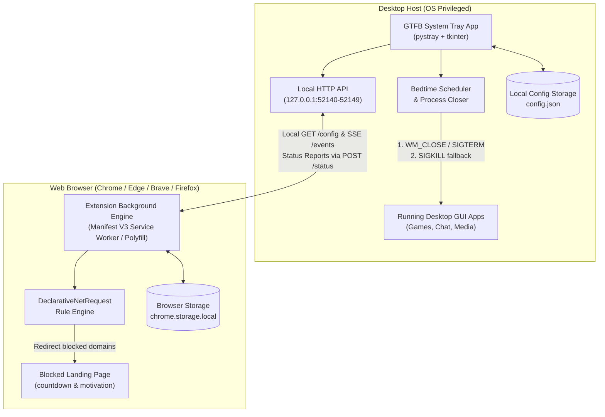

# GTFB — The Anti-Distraction Suite

> Protect your sleep and regain your focus. GTFB closes distracting desktop apps and blocks time-sink websites on schedules you define — with real, zero-negotiation enforcement.

[](https://www.python.org/)
[](https://developer.mozilla.org/en-US/docs/Mozilla/Add-ons/WebExtensions)
[](docs/cross-platform.md)
[](docs/firefox_guide.md)
[](#privacy--architecture-principles)
[](LICENSE)

---

## Table of Contents

- [The Core Problem](#the-core-problem)
- [System Overview & Architecture](#system-overview--architecture)
- [Key Features](#key-features)
- [Quickstart & Installation](#quickstart--installation)
  - [1. Desktop Tray Application](#1-desktop-tray-application)
  - [2. Browser Companion Extension](#2-browser-companion-extension)
  - [3. Building Standalone Binaries](#3-building-standalone-binaries)
- [Configuration & Usage](#configuration--usage)
  - [Desktop Tray Menu](#desktop-tray-menu)
  - [Unified Settings Window](#unified-settings-window)
  - [Command-Line Interface (CLI)](#command-line-interface-cli)
  - [OS Startup Integration](#os-startup-integration)
- [Local Sync & API Architecture](#local-sync--api-architecture)
- [Known Limitations & Trust Prompts](#known-limitations--trust-prompts)
- [Post-V1 Roadmap](#post-v1-roadmap)
- [Repository Layout](#repository-layout)
- [Documentation Index](#documentation-index)
- [Development & Testing](#development--testing)

---

## The Core Problem

Most people who lose hours to late-night doomscrolling or daytime tab-switching do not suffer from a lack of awareness — they already know they should be sleeping or working. The problem is **zero friction**: closing a reminder dialog takes one click, and opening a new browser tab to Reddit, YouTube, or social media takes under two seconds.

When distraction requires zero effort, willpower consistently loses.

**GTFB** acts as the automated obstacle between the impulse and the distraction. By combining an **OS-privileged desktop daemon** with a **cross-browser extension**, GTFB enforces your scheduled boundaries directly at the operating system and browser network layers — leaving nothing to negotiate with in the moment of temptation.

---

## System Overview & Architecture

GTFB consists of two lightweight, independent components connected via a secure, loopback-only local sync loop:



### Privacy & Architecture Principles
- **100% Local & Private:** No accounts, no cloud servers, and zero telemetry. All configuration, logs, and rules stay strictly on your machine.
- **Offline & Crash Resilient:** The browser extension caches rules in browser storage (`chrome.storage.local`). If the desktop app is closed or restarting, active website blocking continues without interruption.
- **Single Source of Truth:** Manage your bedtime schedule, grace periods, and blocked domain lists once in the desktop Settings window — changes propagate automatically across all installed browsers.

---

## Key Features

- **Smart OS-Level Application Closer**  
  Scans active processes, accurately distinguishes user GUI applications from essential system daemons, sends graceful close signals (`WM_CLOSE` / `SIGTERM`), and enforces fallback termination after a configurable grace period.
- **Cross-Browser Website Blocking**  
  Uses native WebExtensions Manifest V3 `declarativeNetRequest` rules to block distracting domains on **Google Chrome**, **Microsoft Edge**, **Brave**, and **Mozilla Firefox** with zero network latency.
- **Instant Localhost Synchronization**  
  Embedded loopback API server (`127.0.0.1`) keeps browser extensions synchronized with desktop settings via dynamic port discovery and real-time events.
- **System Tray Background Daemon**  
  Lives quietly in your Windows Notification Area, macOS Menu Bar, or Linux System Tray with live countdown tooltips, dynamic colored status icons, and quick-action menus.
- **Unified Settings GUI**  
  A clean desktop settings window to adjust bedtime hours, shutdown toggles, startup options, and manage blocked domain lists with duplicate detection and URL sanitization.
- **Automated Startup Integration**  
  One-click registration for Windows Startup (visible in Windows Task Manager > Startup apps), macOS LaunchAgents, or Linux XDG autostart.
- **Crash-Proof Atomic Storage**  
  Config and port files use atomic write-and-rename patterns with automatic backup fallback to ensure settings are never corrupted by unexpected shutdowns.


---

## Quickstart & Installation

### 1. Desktop Tray Application

#### Option A: Pre-Built Standalone Binaries (Recommended)
Download the latest release for your platform from [Releases](https://github.com/recurzes/gtfb/releases):
- **Windows:** Download and run `gtfb.exe`.
- **macOS:** Download `GTFB.app`. (On first run, right-click `GTFB.app` and select **Open** to clear Gatekeeper).
- **Linux:** Download `gtfb`, make it executable (`chmod +x gtfb`), and run `./gtfb`.

#### Option B: Developer / Python Installation
GTFB requires Python 3.11+ and uses [`uv`](https://github.com/astral-sh/uv) or standard `pip`:

```bash
# Clone the repository
git clone https://github.com/recurzes/gtfb.git
cd gtfb

# Install dependencies using uv (recommended)
uv sync
uv pip install -e .

# Or using standard pip
pip install -e .

# Launch GTFB
gtfb
# or
python -m gtfb.app
```

> **Platform Note for Linux users:** Ensure `libayatana-appindicator3-1` or `gir1.2-ayatanaappindicator3-0` is installed. See the [Cross-Platform Guide](docs/cross-platform.md) for distro-specific packages.

---

### 2. Browser Companion Extension

The browser extension works on Google Chrome, Microsoft Edge, Brave, and Mozilla Firefox.

#### Guided Setup (Built-in Assistant)
On first launch, GTFB automatically deploys the extension files to your user profile and opens the interactive **Extension Setup Assistant**. You can also open this assistant anytime from the system tray menu via **Extension Setup...**.

#### Manual Installation Steps

##### For Chromium Browsers (Google Chrome, Microsoft Edge, Brave):
1. Open your browser and navigate to the extensions page:
   - **Chrome:** `chrome://extensions`
   - **Edge:** `edge://extensions`
   - **Brave:** `brave://extensions`
2. Toggle on **Developer mode** (top-right corner).
3. Click **Load unpacked**.
4. Select the `extension/` directory from the GTFB repository (or your deployed `%APPDATA%/GTFB/extension` folder).

##### For Mozilla Firefox:
1. Open Firefox and navigate to `about:debugging#/runtime/this-firefox`.
2. Click **Load Temporary Add-on...**.
3. Select `extension/manifest.json` from the `extension/` directory.

*(For detailed Firefox packaging and permanent developer profile setup, see the [Firefox Guide](docs/firefox_guide.md).)*

---

### 3. Building Standalone Binaries

GTFB includes automated PyInstaller packaging scripts for all three major operating systems:

```powershell
# Windows (.exe)
python scripts/build_windows.py
# or double-click scripts/build_windows.bat
```

```bash
# macOS (.app bundle)
python scripts/build_macos.py
# or run bash scripts/build_macos.sh
```

```bash
# Linux (standalone binary + desktop entry)
python scripts/build_linux.py
# or run bash scripts/build_linux.sh
```

Detailed platform packaging guides:
- [Windows Build Guide](docs/BUILD_WINDOWS.md)
- [macOS Build Guide](docs/BUILD_MACOS.md)
- [Linux Build Guide](docs/BUILD_LINUX.md)

---

## Configuration & Usage

### Desktop Tray Menu

Click the GTFB icon in your system tray / menu bar to access controls:

| Menu Item | Action |
|---|---|
| **Status Indicator** | Displays current countdown to bedtime and connected browser status. |
| **Start / Stop Scheduler** | Toggles bedtime countdown and automated app closing. |
| **Settings...** | Opens the unified configuration window. |
| **Extension Setup...** | Opens the step-by-step browser extension installation guide. |
| **Dry Run Check** | Scans and logs detectable GUI applications without closing anything. |
| **Check System Readiness** | Validates OS platform support, tray backends, and permission status. |
| **Quit GTFB** | Cleanly exits the tray application and shuts down the local API server. |

### Visual Status Indicators

| Icon | State | Meaning |
|---|---|---|
| **Green** | **Active & Synced** | Scheduler running, bedtime countdown active, extension connected. |
| **Yellow** | **Warning / Disconnected** | Scheduler running, but browser extension has not synced recently. |
| **Gray** | **Idle / Paused** | Scheduler paused or manual override active. |
| **Red** | **Bedtime Triggered** | Bedtime reached; app closing and site redirection in progress. |


### Unified Settings Window

Open **Settings...** from the tray menu to configure:
- **Bedtime Schedule:** Target hour (`0–23`) and minute (`0–59`).
- **Grace Period:** Time allowed for graceful app closure (`0–300` seconds, default: 30s).
- **System Shutdown:** Toggle whether to power off the computer after closing applications.
- **Windows / OS Startup:** Enable or disable automatic launch on system login.
- **Blocked Websites:** Add, remove, or edit domains (e.g. `reddit.com`, `youtube.com`, `twitter.com`, `x.com`). Subdomains and path variations are normalized automatically.

When you click **Save Settings**, changes write atomically to disk and broadcast immediately to all connected browser extensions.

### Command-Line Interface (CLI)

GTFB provides full CLI support for headless environments, scripting, and diagnostics:

```bash
# Run GTFB desktop tray app
gtfb

# Run platform diagnostics and backend verification
gtfb --check-system

# Perform a dry-run scan (lists open GUI apps that would close at bedtime)
gtfb --dry-run

# Run bedtime countdown for a custom time (e.g. 23:15) without OS shutdown
gtfb --hour 23 --minute 15 --no-shutdown

# Register GTFB in Windows Startup (runs automatically on login)
gtfb --install-startup

# Remove GTFB from Windows Startup
gtfb --remove-startup

# Open the Windows Startup folder in File Explorer
gtfb --open-startup-folder
```

### OS Startup Integration

- **Windows:** Toggle in Settings or run `gtfb --install-startup`. GTFB appears in **Windows Task Manager > Startup apps** and **Windows Settings > Apps > Startup** with verified executable paths.
- **macOS:** LaunchAgent plist configuration support in `~/Library/LaunchAgents/`.
- **Linux:** XDG autostart `.desktop` file installed to `~/.config/autostart/`.

---

## Local Sync & API Architecture

GTFB uses a secure, local-only HTTP API running on loopback (`127.0.0.1`). The server dynamically binds to the first available port in the `52140–52149` range and publishes the active port to `api_port.json`.

```
Desktop Tray App (127.0.0.1:52140)
  ├── GET  /health   -> { "status": "ok", "version": "0.1.0" }
  ├── GET  /config   -> { "bedtime": {...}, "block_rules": [...] }
  ├── GET  /events   -> Server-Sent Events (real-time config push)
  └── POST /status   <- { "browser": "chrome", "enforcing": true }
```

### Storage Locations

All user configuration, logs, and state files are kept in OS-standard data directories away from project workspace folders:

| Platform | Configuration & Log Directory |
|---|---|
| **Windows** | `%APPDATA%\GTFB\` (`config.json`, `bedtime.log`, `api_port.json`) |
| **macOS** | `~/Library/Application Support/GTFB/` |
| **Linux** | `~/.config/gtfb/` (or `$XDG_CONFIG_HOME/gtfb/`) |

---

## Known Limitations & Trust Prompts

- **Unsigned Binary Warnings (SmartScreen & Gatekeeper):**  
  Because GTFB is an open-source, unsigned independent application, operating systems may show security prompts on first run:
  - **Windows:** Click *"More info"* → *"Run anyway"*.
  - **macOS:** Right-click `GTFB.app` in Finder and select *"Open"*, then confirm the prompt.
- **Extension Removal Friction:**  
  Deliberately disabling or removing the browser extension removes browser-level blocking. A deeper, kernel/hosts-level blocking mechanism is planned for Post-V1 (see below).
- **Linux Wayland Tray Support:**  
  Some Wayland desktop environments require the Ayatana AppIndicator GNOME extension to display system tray icons. GTFB gracefully falls back to CLI mode if no tray daemon is present.

---

## Post-V1 Roadmap

Features planned for subsequent releases (from Masterplan parked items):

- [ ] **Strict / Friction Override Mode:** Require completing a typing challenge or waiting through a 5-minute cooldown before unblocking sites during an active session.
- [ ] **Work-Hours Whitelist Exceptions:** Context-aware filtering (e.g. allow YouTube for educational/work queries during the day, block at night).
- [ ] **Hardcore Mode (Hosts-File / DNS Enforcement):** OS-level domain blocking to prevent browser-extension bypass.
- [ ] **Privacy-Preserving Focus Analytics:** Local-only dashboards visualizing time saved and habit consistency over time.
- [ ] **Calendar & Weekend Profiles:** Flexible schedules that automatically adjust bedtime rules on weekends or holidays.

---

## Repository Layout

```
gtfb/
├── assets/                  # Application icons, graphics, and blocked page assets
│   └── icons/
├── docs/                    # In-depth architectural, platform, and setup guides
│   ├── BUILD_LINUX.md       # Linux binary compilation and packaging guide
│   ├── BUILD_MACOS.md       # macOS app bundle compilation guide
│   ├── BUILD_WINDOWS.md     # Windows executable compilation guide
│   ├── USER_GUIDE.md        # Comprehensive end-user documentation & walkthrough
│   ├── api_reference.md     # Local HTTP API endpoint and protocol reference
│   ├── cross-platform.md    # Multi-OS compatibility and requirements guide
│   ├── e2e_testing.md       # Manual and automated E2E testing procedures
│   └── firefox_guide.md     # Firefox Add-on setup and polyfill notes
├── extension/               # Cross-browser companion extension (Manifest V3)
│   ├── manifest.json        # Extension manifest (MV3 Chrome/Edge/Firefox)
│   ├── background.js        # Background service worker & sync engine
│   ├── blocked.html         # Custom distraction blocking landing page
│   ├── popup.html           # Quick status and sync popup UI
│   └── lib/                 # WebExtension polyfill for Firefox compatibility
├── notes/                   # Architecture specs, masterplans, and development roadmaps
│   ├── specs/               # 35 feature specifications across Stages 1–6
│   ├── GTFB_Masterplan.md   # Architectural masterplan & design decisions
│   └── GTFB_Branch_Roadmap.md # 35-step development roadmap
├── packaging/               # PyInstaller specs and OS packaging assets
│   ├── linux/
│   ├── macos/
│   └── windows/
├── scripts/                 # Build scripts and test runners
│   ├── build_linux.py / .sh
│   ├── build_macos.py / .sh
│   ├── build_windows.py / .bat
│   └── test_api.py
├── src/
│   └── gtfb/                # Main Python application package
│       ├── app.py           # Application entry point & CLI parser
│       ├── config.py        # Schema, defaults, and atomic storage manager
│       ├── core/            # Process detection, closer, and bedtime scheduler
│       │   ├── closer.py
│       │   ├── platform_utils.py
│       │   ├── sanitizer.py
│       │   └── scheduler.py
│       └── ui/              # Desktop GUI, system tray, and local API server
│           ├── api_server.py
│           ├── extension_installer.py
│           ├── icons.py
│           ├── settings_window.py
│           ├── tray.py
│           └── ui_manager.py
├── tests/                   # Automated unit and integration test suite (320+ tests)
├── pyproject.toml           # Package metadata, scripts, and dependencies
└── README.md                # Project documentation and quickstart
```

---

## Documentation Index

For detailed guides, please refer to:
- **[User Overview & User Guide](docs/USER_GUIDE.md):** Complete guide to features, configuration, and best practices.
- **[Cross-Platform Guide](docs/cross-platform.md):** Platform requirements, permissions, and behavior notes for Windows, macOS, and Linux.
- **[Firefox Compatibility Guide](docs/firefox_guide.md):** Step-by-step Firefox Add-on setup and temporary/developer installation.
- **[Local API Reference](docs/api_reference.md):** Endpoints, payload contracts, SSE events, and security specifications.
- **[Windows Build Guide](docs/BUILD_WINDOWS.md):** Building standalone `gtfb.exe` binaries with PyInstaller.
- **[macOS Build Guide](docs/BUILD_MACOS.md):** Building `GTFB.app` bundles on macOS.
- **[Linux Build Guide](docs/BUILD_LINUX.md):** Building Linux standalone binaries and desktop launchers.
- **[End-to-End Testing Guide](docs/e2e_testing.md):** Comprehensive manual and automated verification checklist.


---

## Development & Testing

### Running Tests

GTFB comes with a comprehensive automated test suite covering configuration serialization, process closing algorithms, local API endpoints, extension sync loops, and cross-platform utilities:

```bash
# Run all unit and integration tests
uv run pytest

# Run with verbose output
uv run pytest -v

# Run specific subsystem tests
uv run pytest tests/test_config_atomic.py
uv run pytest tests/test_api_server.py
uv run pytest tests/test_extension_poll_config.py
```

### Manual Testing of Local API

You can test the local API directly via the included test script:

```bash
python scripts/test_api.py
```

---

## License

GTFB is open-source software licensed under the [MIT License](LICENSE).
