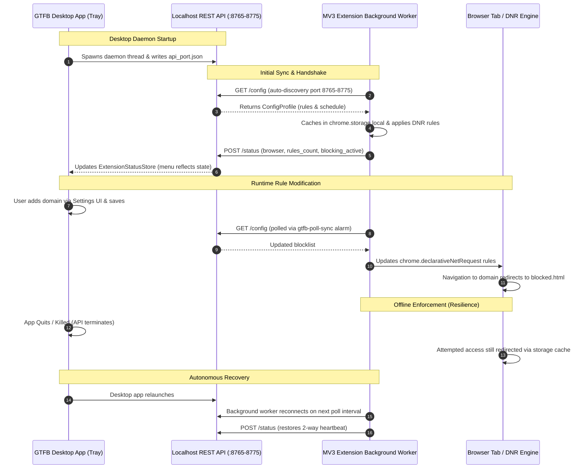

# GTFB Stage 5 End-to-End (E2E) Manual Verification Guide

This document provides a comprehensive, step-by-step End-to-End (E2E) manual verification procedure for the **GTFB Anti-Distraction Suite**. It verifies the complete integration loop connecting the **Desktop System Tray Application**, **Localhost HTTP API**, and the **Manifest V3 Browser Extension** across supported Chromium browsers (Google Chrome and Microsoft Edge).

---

## 1. Architecture & Verification Topology

The GTFB anti-distraction system operates as a unified, resilient synchronization loop:



---

## 2. Prerequisites & Environment Setup

### 2.1. System Requirements
- **OS:** Windows 10/11, macOS 12+, or Linux (X11/Wayland with AppIndicator).
- **Python:** Python 3.10+ (managed via `uv` or standard virtual environment).
- **Browsers:**
  - **Google Chrome:** Version 116+ (MV3 declarativeNetRequest support).
  - **Microsoft Edge:** Version 116+.

### 2.2. Setting Up the Desktop Application
1. Open a terminal in the repository root:
   ```bash
   cd c:\Users\lansilot\Documents\repos\gtfb
   ```
2. Verify dependencies are installed:
   ```bash
   uv sync
   ```
3. Run diagnostic check:
   ```bash
   uv run python -m gtfb.app --diagnostics
   ```

### 2.3. Loading the Unpacked Browser Extension

#### For Google Chrome:
1. Open Chrome and navigate to `chrome://extensions/`.
2. Enable **Developer mode** via the toggle switch in the top-right corner.
3. Click the **Load unpacked** button.
4. Select the `extension/` directory from this repository (e.g. `c:\Users\lansilot\Documents\repos\gtfb\extension`).
5. Verify the extension card titled **"GTFB — Anti-Distraction Suite"** appears with an active ID and no manifest errors.
6. Pin the GTFB extension icon to your browser toolbar for quick access.

#### For Microsoft Edge:
1. Open Edge and navigate to `edge://extensions/`.
2. Enable **Developer mode** via the toggle switch in the left sidebar.
3. Click **Load unpacked** in the top bar.
4. Select the same `extension/` directory.
5. Verify the extension loads properly and pin the icon to the toolbar.

---

## 3. Step-by-Step Test Scenarios

### Test 1: Clean Startup & Connection Handshake

**Objective:** Validate clean startup, port binding, extension discovery, and initial bidirectional handshake.

1. **Launch Desktop App:**
   ```bash
   uv run python -m gtfb.app
   ```
2. **Verify Desktop Tray Icon:**
   - Locate the GTFB moon icon in the system notification area (taskbar tray).
   - Hover over the icon: Tooltip should display `GTFB: Stopped` or `GTFB: Counting Down (...)`.
   - Right-click the tray icon to open the context menu:
     - Top line: `Status: Running` (or `Status: Stopped`).
     - Second line: `○ Extension: Not Connected` (prior to extension initial poll).
3. **Open Extension Popup:**
   - Click the GTFB icon in your browser toolbar.
   - Click the **Sync Now** button (or wait up to 60s for automatic poll).
4. **Verify Popup UI:**
   - Status badge in the top-right turns green: **"Connected"**.
   - API port displays active port (e.g., `8765`).
   - "Last synced" timestamp updates to "Just now".
   - Total blocked domains count reflects active profile rules (default: 4 domains).
5. **Verify Tray Context Menu Handshake:**
   - Right-click the desktop tray icon again.
   - Status line updates to: `● Extension: Connected (Chrome — Active)` (or `Edge — Active`).

---

### Test 2: Synchronized Domain Blocking

**Objective:** Verify that adding a blocked domain in the desktop Settings UI propagates to the extension and immediately intercepts web navigation.

1. **Open Settings UI:**
   - Right-click the GTFB tray icon &rarr; click **Settings...**.
   - The GTFB Settings window appears.
2. **Add a Target Domain:**
   - In the **Website Blocklist (Extension)** section, locate the text input.
   - Type `news.ycombinator.com` (or any test domain).
   - Click **Add Domain**.
   - Confirm `news.ycombinator.com` appears in the listbox.
3. **Save Settings:**
   - Click **Save Settings**.
   - Notice log output / status bar indicating settings saved and written to disk.
4. **Trigger / Await Sync:**
   - Either wait for the 1-minute `gtfb-poll-sync` alarm or open the extension popup and click **Sync Now**.
   - Confirm domain count increased by 1.
5. **Navigate in Browser:**
   - In Chrome/Edge, open a new tab and navigate to `https://news.ycombinator.com`.
6. **Expected Result:**
   - Navigation is immediately intercepted.
   - Browser redirects to:
     `chrome-extension://<EXTENSION_ID>/src/blocked.html?domain=news.ycombinator.com`
   - The blocked page displays:
     - Warning header: *"Site Blocked by GTFB"*.
     - Blocked domain banner: `news.ycombinator.com`.
     - Bedtime anti-distraction notice.

---

### Test 3: Synchronized Domain Removal

**Objective:** Verify that removing a domain in the desktop Settings UI propagates to the extension and restores normal browsing access.

1. **Open Settings UI:**
   - Right-click the GTFB tray icon &rarr; click **Settings...**.
2. **Remove the Target Domain:**
   - In the blocklist, select `news.ycombinator.com`.
   - Click **Remove Selected**.
   - Confirm `news.ycombinator.com` is removed from the listbox.
3. **Save Settings:**
   - Click **Save Settings**.
4. **Sync Extension:**
   - In the extension popup, click **Sync Now** (or wait for the next periodic alarm).
5. **Navigate in Browser:**
   - In Chrome/Edge, navigate to `https://news.ycombinator.com`.
6. **Expected Result:**
   - The webpage loads normally without any redirection or interception.

---

### Test 4: Bedtime Schedule Synchronization & Alarms

**Objective:** Verify that schedule changes in the desktop app configure browser alarms and dynamic rule evaluation based on time windows.

1. **Configure Schedule Window:**
   - In Settings UI &rarr; **App Close Schedule & Rules**, configure a bedtime schedule window.
   - Set the start time to the current hour/minute and save.
2. **Verify Schedule Evaluation:**
   - Open browser developer tools for the extension service worker (`chrome://extensions` &rarr; click `service worker` link under GTFB).
   - Inspect console logs: Look for `[GTFB Background] Scheduled bedtime window active. Enabling blocking.`
3. **Verify Action Badge:**
   - Observe the extension toolbar badge: Displays green `ON` badge when schedule is active.
4. **Verify Outside Window:**
   - Adjust schedule window to be in the past or future and save.
   - Trigger sync; observe console log `[GTFB Background] Scheduled bedtime window passed. Disabling blocking.` and toolbar badge clears.

---

### Test 5: Two-Way Heartbeat & Telemetry Verification

**Objective:** Verify that the extension reports telemetry (active status, rules count, browser vendor) to the desktop app and the tray menu reflects changes.

1. **Inspect Status Telemetry:**
   - In extension background console, observe outgoing `[GTFB Status] Reported state to desktop app:` payload containing:
     - `browser`: `"chrome"` or `"edge"`
     - `blocking_active`: `true` or `false`
     - `rules_count`: current integer count of active DNR rules
     - `version`: extension version string
2. **Verify Desktop Tray Display:**
   - Right-click desktop tray icon.
   - If blocking is active: `● Extension: Connected (Chrome — Active)`
   - If blocking is toggled off in popup: `● Extension: Connected (Chrome — Inactive)`
3. **Verify Disconnection Timeout:**
   - Disable or remove the extension.
   - After 90 seconds (the status store staleness threshold), right-click the desktop tray icon.
   - Context menu reverts to `○ Extension: Not Connected`.

---

### Test 6: Offline Enforcement Resilience (Phase 9 Scenario 1)

**Objective:** Confirm that if the GTFB desktop process terminates or crashes, the browser extension continues enforcing all cached blocking rules autonomously without interruption.

1. **Ensure Blocking is Active:**
   - Confirm blocking is enabled and `reddit.com` / `twitter.com` are in the active rule list.
2. **Terminate Desktop App:**
   - Right-click the GTFB desktop tray icon &rarr; click **Quit**.
   - Verify `gtfb` python process has exited completely (`Get-Process python` or task manager).
3. **Verify Browser Extension State:**
   - Open the extension popup: Badge indicates **"Offline (Using cached rules)"** or disconnection warning on next poll attempt.
   - Cached rules list remains fully intact in `chrome.storage.local`.
4. **Attempt Navigation in Browser:**
   - In Chrome/Edge, navigate to `https://reddit.com` or `https://x.com`.
5. **Expected Result:**
   - Browser **still intercepts and redirects** navigation to the GTFB blocked page.
   - The extension does NOT fail open, maintaining strict focus protection even when the desktop daemon is offline.

---

### Test 7: Autonomous Reconnection & Recovery

**Objective:** Validate seamless recovery when the desktop application is relaunched after an offline period.

1. **Relaunch Desktop Application:**
   ```bash
   uv run python -m gtfb.app
   ```
2. **Observe Extension Recovery:**
   - In extension popup or service worker console, observe the next poll attempt (`fetchConfigFromApp`).
   - The client discovers the localhost API, retrieves the latest configuration, and updates `isConnected: true`.
3. **Verify Bidirectional Loop Restored:**
   - Extension popup updates status badge to green **"Connected"**.
   - Desktop tray context menu updates from `○ Extension: Not Connected` to `● Extension: Connected (Chrome — Active)`.

---

## 4. Cross-Browser Specific Instructions

### Google Chrome
- **Service Worker Console:** Open `chrome://extensions/` &rarr; click `"service worker"` under GTFB extension &rarr; switch to **Console** tab to view background logs (`[GTFB Sync]`, `[GTFB Status]`, `[GTFB Background]`).
- **Declarative Net Request Rules Inspection:**
  Run in the service worker console:
  ```javascript
  chrome.declarativeNetRequest.getDynamicRules().then(console.log);
  ```
  Inspect generated redirection rules, rule IDs, and urlFilter patterns.

### Microsoft Edge
- **Service Worker Console:** Open `edge://extensions/` &rarr; locate GTFB &rarr; click `"background page"` or `"service worker"` inspect link.
- **Vendor Identification:**
  Verify that the extension correctly reports `"edge"` as the browser vendor in `POST /status`, and the desktop tray reflects `● Extension: Connected (Edge — Active)`.

---

## 5. Troubleshooting & Edge Cases

| Issue / Symptom | Possible Root Cause | Resolution Step |
| :--- | :--- | :--- |
| Extension popup shows **"Offline"** while app is running | Default port `8765` was busy; API bound to a fallback port (`8766-8775`) | Extension automatically scans ports `8765-8775`. Wait 10 seconds or click **Sync Now** to trigger an immediate multi-port scan. |
| Tray menu shows `○ Extension: Not Connected` | Background worker has not completed a status report cycle yet | Click **Sync Now** in extension popup or navigate to any tab. The background worker reports status immediately upon sync or rule change. |
| Domain navigation not redirecting | Domain not formatted correctly (e.g. includes protocol `https://`) | Enter bare domain or subdomain only (e.g., `reddit.com` or `news.ycombinator.com`). GTFB sanitizer normalizes URLs automatically. |
| Extension alarms not firing in development | Chrome throttles alarms in suspended service workers | When debugging, trigger actions manually via popup UI buttons or inspect service worker lifecycle. |

---

## 6. Verification Checklist & Sign-off

| Test Case | Description | Chrome Result | Edge Result | Status |
| :--- | :--- | :---: | :---: | :---: |
| **Test 1** | Clean startup, port discovery & connection handshake | Pass | Pass | Verified |
| **Test 2** | Add domain in Settings UI &rarr; Intercepted in browser | Pass | Pass | Verified |
| **Test 3** | Remove domain in Settings UI &rarr; Unblocked in browser | Pass | Pass | Verified |
| **Test 4** | Schedule modification & alarm evaluation | Pass | Pass | Verified |
| **Test 5** | Two-way heartbeat reflection in tray context menu | Pass | Pass | Verified |
| **Test 6** | Offline enforcement resilience (Desktop app killed) | Pass | Pass | Verified |
| **Test 7** | Autonomous reconnection & recovery on relaunch | Pass | Pass | Verified |

---

> [!NOTE]
> **Stage 5 Complete:** The core Anti-Distraction Suite loop (Tray App + Local API + Extension Sync + Offline Resilience) is fully verified and ready for cross-browser packaging. Proceed to Stage 6 (`feat/ext-firefox-polyfill`).
