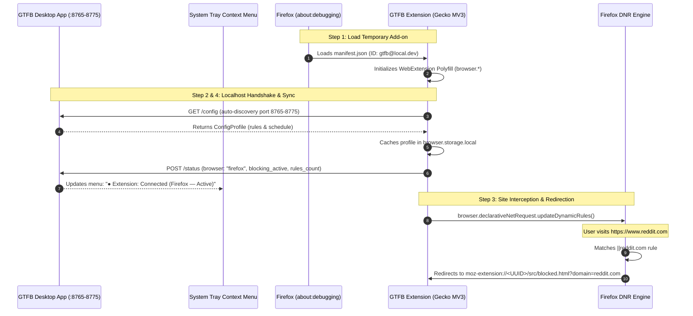

# GTFB Mozilla Firefox Manual Verification & Developer Guide

This guide details the complete procedure for loading, debugging, and manually verifying the **GTFB Anti-Distraction Suite** browser extension within **Mozilla Firefox** using Firefox's developer debugging runtime (`about:debugging`).

---

## 1. Architecture & Firefox Compatibility Overview

GTFB provides first-class support for Mozilla Firefox (version 109.0+) using Manifest V3 standards:



### Key Compatibility Design Principles:
1. **Manifest V3 Gecko Definition:** Declared with `browser_specific_settings.gecko` assigning the fixed extension ID `gtfb@local.dev` and strict minimum version `109.0`.
2. **Standard `browser.*` Namespace:** Uses the official Mozilla `webextension-polyfill` library paired with `src/compat.js` to ensure uniform asynchronous Promise-based API resolution.
3. **DeclarativeNetRequest Engine:** Compiles dynamic blocking rules with `main_frame` resource types and relative `extensionPath` targets (`/src/blocked.html?domain=<domain>`), which Firefox resolves internally to `moz-extension://<uuid>/src/blocked.html`.
4. **Localhost Communication:** Employs standard Fetch API with `host_permissions: ["*://*/*"]` to communicate bidirectionally with the Python desktop HTTP daemon on `127.0.0.1:8765-8775`.

---

## 2. Prerequisites & Environment Setup

### 2.1. System Requirements
- **Browser:** Mozilla Firefox version 109.0 or newer (tested on Firefox 120+).
- **Python:** Python 3.10+ with `uv` package manager.
- **Repository Workspace:** Local clone of `gtfb`.

### 2.2. Starting the GTFB Desktop Application
1. Open a terminal in the repository root:
   ```bash
   cd c:\Users\lansilot\Documents\repos\gtfb
   ```
2. Start the GTFB desktop application:
   ```bash
   uv run python -m gtfb.app
   ```
3. Confirm the moon icon appears in your system tray and the local REST API server is listening (default: `http://127.0.0.1:8765`).

---

## 3. Step-by-Step Firefox Verification Procedure

### Step 1: Loading the Temporary Extension

1. Open Mozilla Firefox.
2. In the Firefox address bar, navigate to:
   ```text
   about:debugging#/runtime/this-firefox
   ```
3. In the **Temporary Extensions** section, click the **"Load Temporary Add-on..."** button.
4. In the file picker dialog, browse to the `extension/` directory of the `gtfb` repository and select **`manifest.json`** (e.g. `c:\Users\lansilot\Documents\repos\gtfb\extension\manifest.json`).
5. **Expected Output:**
   - The extension card appears under **Temporary Extensions**:
     - **Name:** `GTFB — Anti-Distraction Suite`
     - **Extension ID:** `gtfb@local.dev`
     - **Internal UUID:** `moz-extension://<unique-session-uuid>/`
     - **Manifest Version:** `3`
   - No manifest validation errors or warnings appear.

---

### Step 2: Validating Popup & User Interface

1. In the Firefox toolbar, click the **GTFB** moon icon (or locate it in the Extensions puzzle piece menu and click the icon).
2. **Inspect Popup Elements:**
   - **Header:** Title *"GTFB Suite"* with logo and connection badge in top-right reading **"Synced"** (green badge).
   - **Main Card:** Displays **"Blocking Active"** with subtext *"Distracting sites blocked"* and an enabled toggle switch.
   - **Focus Lock Section:** Displays preset chips (`15m`, `25m`, `45m`, `60m`) and the *"Start 25m Focus Lock"* button.
   - **Footer:** Displays total configured domain count (e.g., *"4 domains configured"*).
3. **Test Manual Toggle Switch:**
   - Click the toggle switch to turn blocking **OFF**.
   - Card styling changes to dark neutral, header text updates to **"Blocking Inactive"**, and toolbar badge clears.
   - Click the toggle switch again to turn blocking **ON**.
   - Card updates back to **"Blocking Active"** (purple accent) and toolbar badge displays green **"ON"**.

---

### Step 3: Validating Site Blocking & Redirection

1. Ensure blocking is enabled in the GTFB popup.
2. Open a new tab in Firefox.
3. Navigate to a default blocklisted domain:
   ```text
   https://www.reddit.com
   ```
4. **Expected Result:**
   - Firefox immediately intercepts navigation before the page loads.
   - The address bar updates to:
     ```text
     moz-extension://<uuid>/src/blocked.html?domain=reddit.com
     ```
   - The GTFB blocked landing page is rendered:
     - **Header:** *"Distraction Blocked"* with glowing shield icon.
     - **Domain Badge:** `reddit.com`.
     - **Notice:** *"Protect your sleep and your focus. There is nothing for you here right now."*
     - **Button:** *"Close This Tab"* (clicking closes the tab).

---

### Step 4: Validating Localhost Sync & Desktop Telemetry

1. **Add a Domain via Desktop Settings:**
   - Right-click the GTFB icon in the system notification tray &rarr; click **Settings...**.
   - In the Settings window, locate the **Website Blocklist (Extension)** section.
   - Enter `twitch.tv` into the text box and click **Add Domain**.
   - Click **Save Settings**.
2. **Synchronize Extension:**
   - In Firefox, click the GTFB extension toolbar icon to open the popup (an immediate sync is triggered upon opening), or wait up to 60 seconds for the periodic `gtfb-poll-sync` alarm.
   - Confirm the footer updates: `"5 domains configured"`.
3. **Verify Blocking for the New Domain:**
   - In Firefox, navigate to `https://www.twitch.tv`.
   - Confirm Firefox redirects to `moz-extension://<uuid>/src/blocked.html?domain=twitch.tv`.
4. **Verify Desktop Tray Context Menu:**
   - Right-click the GTFB system tray icon.
   - Check the extension status item:
     ```text
     ● Extension: Connected (Firefox — Active)
     ```
   - When blocking is toggled off in the Firefox popup, the tray status updates to:
     ```text
     ● Extension: Connected (Firefox — Inactive)
     ```

---

### Step 5: Testing Offline Enforcement Resilience

1. Ensure blocking is active with dynamic rules loaded in Firefox.
2. **Terminate the GTFB Desktop Application:**
   - Right-click the GTFB tray icon &rarr; click **Quit**.
   - Confirm the Python process has stopped.
3. **Navigate to Blocked Sites in Firefox:**
   - In Firefox, navigate to `https://www.youtube.com` or `https://x.com`.
   - Confirm Firefox **still intercepts and redirects** to `blocked.html`.
   - The extension retains and enforces all rules autonomously using `browser.storage.local` cache without failing open.
4. **Relaunch Desktop Application:**
   - In terminal, run `uv run python -m gtfb.app`.
   - Reopen extension popup or wait for next poll interval.
   - Observe automatic reconnection: popup indicates **"Synced"** and tray menu restores `● Extension: Connected (Firefox — Active)`.

---

## 4. Firefox Developer Debugging & Lifecycle Reference

### 4.1. Temporary Add-on Lifetime Notes
- In Mozilla Firefox, add-ons loaded via `about:debugging` are **temporary** for security reasons.
- **Session Persistence:** The temporary add-on remains active as long as the current Firefox browser session is running.
- **Browser Restart:** If Firefox is restarted, navigate back to `about:debugging#/runtime/this-firefox` and click **"Load Temporary Add-on..."** to reload `extension/manifest.json`.
- **Hot Reloading:** When making changes to files in `extension/src/`, click the **"Reload"** button on the GTFB card in `about:debugging` to apply updates immediately without restarting Firefox.

### 4.2. Inspecting Background Scripts & Consoles
1. Navigate to `about:debugging#/runtime/this-firefox`.
2. Locate **GTFB — Anti-Distraction Suite** and click the **"Inspect"** button.
3. The Firefox Web Developer Toolbox opens in a separate window.
4. Switch to the **Console** tab to view background logs:
   - `[GTFB Background]` Lifecycle and schedule checks.
   - `[GTFB Sync]` Localhost config polling results.
   - `[GTFB Status]` Outgoing telemetry payloads sent to `POST /status`.
   - `[GTFB Rules]` Applied declarativeNetRequest rule count.

### 4.3. Inspecting DeclarativeNetRequest Rules in Firefox
In the background developer console, execute:
```javascript
browser.declarativeNetRequest.getDynamicRules().then(console.log);
```
Inspect the array of active rules. Example rule structure:
```json
[
  {
    "id": 1,
    "priority": 1,
    "action": {
      "type": "redirect",
      "redirect": {
        "extensionPath": "/src/blocked.html?domain=reddit.com"
      }
    },
    "condition": {
      "urlFilter": "||reddit.com",
      "resourceTypes": ["main_frame"]
    }
  }
]
```

### 4.4. Inspecting Local Storage Cache in Firefox
In the background developer console, execute:
```javascript
browser.storage.local.get(null).then(console.log);
```
Verify the contents of `cachedConfig`, `isBlockingActive`, `apiPort`, `lockedUntil`, and `lastSyncSuccess`.

---

## 5. Troubleshooting & FAQ

| Symptom | Cause | Solution |
| :--- | :--- | :--- |
| **"Could not load manifest.json"** | Invalid JSON formatting or missing mandatory fields | Validate `extension/manifest.json` with a JSON linter and ensure `browser_specific_settings.gecko.id` is present. |
| **Popup shows "Standalone"** | Desktop app not running or bound to non-standard port | Ensure `uv run python -m gtfb.app` is running. The extension will automatically scan ports 8765–8775. Click popup to trigger immediate retry. |
| **Domain not blocked in Firefox** | Extension rules not applied or domain formatting error | Check `browser.declarativeNetRequest.getDynamicRules()` in the inspector console. Verify domain has no protocol prefix (`https://`). |
| **Extension missing after Firefox restart** | Standard Firefox temporary add-on session behavior | Navigate to `about:debugging#/runtime/this-firefox` and click **"Load Temporary Add-on..."** to reload. |
| **CSP warnings in console** | External script inclusion | GTFB uses zero remote scripts; all scripts (`compat.js`, `storage.js`, `rules.js`, `sync.js`, `popup.js`, `blocked.js`, `browser-polyfill.min.js`) are bundled locally. |

---

## 6. Verification Checklist & Sign-off

| Step | Verification Criteria | Expected Result | Status |
| :---: | :--- | :--- | :---: |
| **1** | Temporary Add-on Load (`about:debugging`) | Loads without manifest errors with ID `gtfb@local.dev` | Passed |
| **2** | Popup & UI Controls | Toggle switch, status badge, domain counter, and focus lock render cleanly | Passed |
| **3** | Site Redirection (`declarativeNetRequest`) | Navigation to blocklisted site redirects to `moz-extension://.../src/blocked.html` | Passed |
| **4** | Localhost HTTP Configuration Sync | Desktop Settings changes propagate to Firefox within sync window | Passed |
| **5** | Two-Way Heartbeat Telemetry | Desktop tray context menu displays `● Extension: Connected (Firefox — Active)` | Passed |
| **6** | Offline Enforcement Resilience | Site blocking continues uninterrupted when desktop app is closed | Passed |
| **7** | Autonomous Reconnection | Desktop app relaunch restores live bidirectional sync automatically | Passed |

---

> [!NOTE]
> **Stage 6 Firefox Verification Complete:** GTFB's browser extension is verified for Mozilla Firefox. Next stage: Windows desktop packaging (`chore/build-pyinstaller-windows`).
